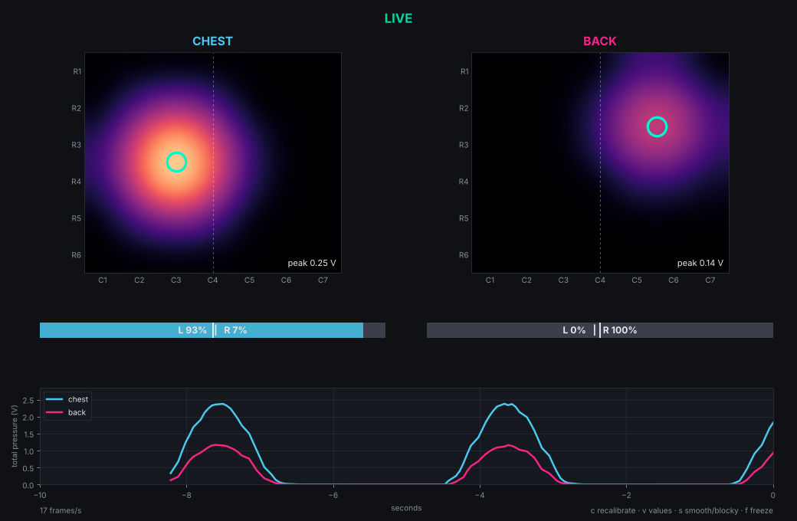

# Tactile Exercise Shirt

Two 6×7 Velostat pressure grids (chest + back) read by an ESP32 through four CD74HC4067 multiplexers, with a live Python heatmap. Built for EE546 Emerging Interactive Technologies, Lab 6.

Based on the course scanning and visualization code, with the two-mux layout and calibrated ADC reads from davmein0/sensor-voltage-visualizer: https://github.com/WellingtonMiao/EE546-EMERGING-INTERACTIVE-TECHNOLOGIES, extended from one 4×4 sensor to two 6×7 sensors.

## Wiring

Set `TWO_MUX` at the top of the firmware to match how your board is built. Pins are the course defaults either way.

**`TWO_MUX 1` (default): 2 mux boards shared by both sensors**

| Connection | ESP32 / destination |
|---|---|
| Column mux S0–S3 | GPIO 33, 25, 26, 27 |
| Row mux S0–S3 | GPIO 21, 22, 23, 14 |
| Column mux SIG | GPIO 36 (VP) + 660 Ω to 3V3 (not 5V) |
| Row mux SIG | GND |
| Both muxes VCC / GND / EN | 3V3 / GND / GND |

| Sensor | Row mux channels | Column mux channels |
|---|---|---|
| Chest | C0–C5 | C0–C6 |
| Back | C6–C11 | C7–C13 |

**`TWO_MUX 0`: 4 mux boards (a row + column pair per sensor)**

Both pairs share the select lines above and use rows C0–C5 / columns C0–C6. Chest column-mux SIG → GPIO 36, back column-mux SIG → GPIO 39 (VN), each with its own 660 Ω pull-up to 3V3. Row-mux SIG → GND, all EN → GND.

The selected row is grounded and the selected column is pulled up to 3.3 V, so the Velostat forms a voltage divider: unpressed reads high, and pressing lowers the voltage. If a strip is on a different mux channel, edit `ROW_CH` / `COL_CH` in the firmware. The ESP32 ADC saturates a little above 3.1 V, so unpressed points may all read the same maximum.

## Fastest: flash from Chrome (no Arduino IDE)

1. Download `firmware/tactile_shirt_esp32.bin`.
2. Open https://espressif.github.io/esptool-js/ in **Chrome or Edge**, plug in the ESP32, click **Connect**, and pick its port.
3. Set **Flash Address** to `0x0`, choose the `.bin`, click **Program**. Hold **BOOT** if it won't connect.
4. Done. Skip to step 3 below.

## Run it

1. Open `firmware/tactile_shirt/tactile_shirt.ino` in Arduino IDE → Board: **ESP32 Dev Module** → Upload (hold BOOT if it stalls).
2. Close the Serial Monitor.
3. `pip install -r python/requirements.txt`
4. `python python/visualize.py COM3` (Mac: `/dev/cu.usbserial-XXXX`)
5. Keep both sensors unloaded for ~2 s while it calibrates.

Options: `--flip-chest` / `--flip-back` to mirror a heatmap, `--log reps.csv --label wide_grip` to save labeled frames, `--no-values` to hide cell numbers.

## Dashboard



Blue-to-green heatmaps on a cell grid with the value in every cell, auto-brightness and center of pressure (ring). Recalibrate button (or `c`), 5 s reading button (or `t`): reports the most-pressed cell on each sensor 5 s after you click and prints it in Terminal,, `v` show cell values, `s` smooth/blocky, `f` freeze.

## Data format

One line per frame at 250000 baud:

```
F,<ms since boot>,<42 chest voltages row by row>,<42 back voltages row by row>
```

## Troubleshooting

- **Stuck on "Calibrating":** wrong port/baud, or Serial Monitor still open.
- **A whole row or column is dead:** bad splice on that strip, or a channel mismatch in `ROW_CH` / `COL_CH`.
- **A whole sensor reads flat:** that mux's EN isn't on GND, or its 660 Ω resistor is missing.
